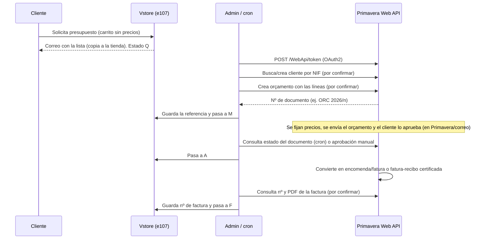

# Integración Vstore ↔ Cegid Primavera ERP v10 (presupuestos y facturación certificada)

Estado: **diseño inicial, con información incompleta** (2026-10-17). Base: *Relatório de Viabilidade Técnica* de KreativeKey (04-09-2026), que confirma que es posible pero **no trae endpoints, campos ni ejemplos**. Todo lo marcado como *(por confirmar)* debe validarse contra la documentación y el entorno de pruebas del cliente antes de programar.

## 1. Qué sabemos y qué no

| Sabemos (del informe) | No sabemos todavía |
|---|---|
| Primavera ERP v10 tiene una **Web API REST** (JSON) sobre IIS, instalada **en el servidor del cliente**; no hay API cloud pública | Si el cliente tiene el módulo **Web API** licenciado |
| Autenticación **OAuth2** `grant_type=password` en `POST /WebApi/token`; token con ~1199 s de validez | Versión exacta de Primavera (v10 *executive* o *professional*) y URL/puerto reales (habitualmente 2018) |
| Ruta tipo `http://servidor:puerto/WebApi/{módulo}/{entidad}/{servicio}` (ej. `WebApi/Base/Clientes/Actualiza`) | **Rutas y cuerpo exactos** para crear un orçamento/encomenda y para convertirlo en fatura |
| Hacen falta: usuario de servicio, `company`, `instance` (normalmente `Default`), `line` (`executive`/`professional`) | Tipos de documento y series configurados en su ERP (orçamento, encomenda, fatura, fatura-recibo) |
| El flujo encaja en el módulo *Marketing e Vendas* | Si el cliente se crea solo en el ERP o hay que crearlo desde Vstore; cómo se mapean los artículos |
| Hay que dar acceso de red seguro entre el servidor web y el ERP (VPN, IP pública + HTTPS o proxy inverso) | Cómo se obtiene el PDF/estado del documento certificado y si hay forma de recibir avisos (probablemente solo consulta periódica) |

## 2. Flujo propuesto

Estados de Vstore ya implementados (v2.1.0): `Q` Presupuesto solicitado → `M` Migrado a la app → `A` Aprobado → `F` Facturado (y `X` Cancelado). Vstore **nunca emite la factura**: la emite Primavera.

Decisiones de diseño:

1. **Primavera es la fuente de verdad** de precios, documento y factura. Vstore solo envía *quién* pide *qué* (cliente, líneas y cantidades) y guarda las referencias devueltas.
2. **Primera versión semi-manual y reversible**: botón "Migrar a la app" por pedido (y por lotes) + modo *vista previa* que muestra el JSON sin enviarlo. Así se puede probar a ciegas con Postman y con el consultor de Primavera antes de automatizar.
3. **Idempotencia**: un presupuesto con referencia externa ya guardada no se vuelve a enviar. Los fallos dejan el estado en `Q` y una línea en el registro del pedido.
4. **Sin cambios de esquema al inicio**: la referencia del documento va en `order_pay_transid` (hoy `NULL` en presupuestos) y la respuesta completa en `order_pay_rawdata`. Si hace falta más (varios documentos por pedido, nº de factura), valorar columnas propias `order_ext_ref` / `order_ext_invoice` con rutina de actualización.
5. **Seguridad**: contraseña del usuario de servicio guardada como el resto de credenciales (enmascarada en el registro, `SecretMask`); solo HTTPS en producción; usuario de servicio con permisos mínimos (Vendas/Faturação); nada de datos personales en los registros de depuración.
6. **Arquitectura** (PHP 7.4, `src/`): interfaz `Vstore\Erp\ErpGateway` (`pushQuote`, `documentStatus`, `invoiceInfo`), implementación `Vstore\Erp\Primavera\PrimaveraClient` (token en caché con caducidad, cliente HTTP Guzzle ya incluido), `QuoteMapper` (pedido → carga útil) y `QuoteMigrationService` (reglas, estados, registro). Pruebas con un cliente HTTP simulado (sin red). Otro ERP en el futuro = otra implementación de la interfaz.

## 3. Datos que Vstore puede aportar de un presupuesto

| Dato en Vstore | Para Primavera |
|---|---|
| `order_refcode` | Referencia/requisición del documento (trazabilidad inversa) |
| Facturación: nombre, empresa, **NIF** (`taxcode` / `vat_id`), dirección, ciudad, CP, país, correo, teléfono | Cliente (buscar por NIF; si no existe, crear o rechazar *(por confirmar)*). Sin NIF: consumidor final |
| Envío (si es distinto) y notas del pedido | Dirección de entrega y observaciones |
| Líneas: `item_code`, nombre, variación, cantidad | Artículo (mapeo código Vstore ↔ código Primavera *(por confirmar)*), cantidad. **Sin precio** |
| Fecha, idioma, moneda | Fecha del documento, idioma de impresión |

## 4. Tareas

### Fase 0 — Descubrimiento (bloquea todo lo demás)
- [ ] **T0.1** Confirmar con el cliente/partner Primavera que el módulo **Web API** está licenciado e instalado, y la versión (v10 *executive*/*professional*).
- [ ] **T0.2** Obtener URL base, puerto, `company`, `instance`, `line` y un **usuario de servicio** (entorno de **pruebas**, no producción) con permisos de Vendas/Faturação.
- [ ] **T0.3** Obtener la **documentación de la Web API del cliente** (o el catálogo de servicios del módulo *Vendas*) con las rutas y el JSON exacto para: buscar/crear cliente, crear **orçamento**, consultar su estado, crear **encomenda/fatura/fatura-recibo** desde él, obtener nº y **PDF** del documento.
- [ ] **T0.4** Guardar 2-3 **peticiones de ejemplo que funcionen** (Postman) y sus respuestas en `docs/primavera/` (sin credenciales).
- [ ] **T0.5** Definir con el cliente: tipos de documento y series, tratamiento del IVA/exenciones, qué hacer con artículos que no existen en el ERP, consumidor final sin NIF, y quién envía el orçamento al cliente (Primavera o correo propio).
- [ ] **T0.6** Resolver el **acceso de red** (VPN, IP pública + HTTPS, proxy inverso) entre el servidor web y el ERP, y pruebas desde el servidor real.
- [ ] **T0.7** Validar con el asesor fiscal el flujo completo y qué documentos ve el cliente (los presupuestos de Vstore ya no generan factura ni consumen numeración).

### Fase 1 — Conector y vista previa
- [ ] **T1.1** `ErpGateway` + `PrimaveraClient` con token OAuth2 en caché y renovación; errores traducidos en `Result`.
- [ ] **T1.2** `QuoteMapper`: pedido → carga útil; **vista previa JSON** en el administrador (sin enviar).
- [ ] **T1.3** Pestaña de administración "ERP / Primavera": URL, company, instance, line, usuario, contraseña (enmascarada), activar/desactivar, botón **Probar conexión**.
- [ ] **T1.4** Pruebas unitarias con cliente HTTP simulado (token, expiración, errores, mapeo).

### Fase 2 — Migración
- [ ] **T2.1** Botón **Migrar a la app** en el pedido `Q` (y acción por lotes): envía, guarda referencia y pasa a `M`; registro en `order_log`; reintento seguro (idempotente).
- [ ] **T2.2** Manejo de cliente inexistente/NIF inválido y de artículos sin correspondencia (aviso claro, el pedido sigue en `Q`).
- [ ] **T2.3** Columna/etiqueta con la referencia externa en la lista de ventas y en el detalle del cliente.

### Fase 3 — Aprobación y facturación
- [ ] **T3.1** Consulta periódica (cron `e_cron.php`) del estado de los documentos en `M`; paso a `A` cuando el orçamento esté aprobado *(por confirmar si la API lo expone)*.
- [ ] **T3.2** Cuando exista la factura certificada: guardar nº (y enlace/PDF si la API lo permite) y pasar a `F`. Correo opcional al cliente.
- [ ] **T3.3** Plan B documentado: avanzar `A` y `F` a mano (ya soportado en el administrador).

### Fase 4 — Producción
- [ ] **T4.1** Prueba de extremo a extremo en pruebas y luego en producción con un pedido real, con el cliente delante.
- [ ] **T4.2** Documentar en el manual y en la Guía de Usuario; registrar en CHANGELOG/plan.

### Ampliaciones a valorar (fuera de esta fase)
- [ ] **A1** Usar el mismo conector para **pedidos de venta pagados** (Mollie/PayPal/transferencia): hoy Vstore genera su propia factura PDF, que **no es certificada**. Si el cliente factura en Portugal, conviene que la factura legal salga siempre de Primavera y que la de Vstore quede como resumen/recibo (consultar con el asesor fiscal).
- [ ] **A2** Sincronizar artículos (importar catálogo, precios y stock desde Primavera).
- [ ] **A3** Recibir la aprobación del cliente desde Vstore (enlace "Aprobar presupuesto" en el correo) y reflejarla en Primavera.

## 5. Riesgos

| Riesgo | Mitigación |
|---|---|
| La API no expone el estado de aprobación o el PDF | Plan B manual (T3.3) y descarga del PDF fuera de Vstore |
| El ERP no es accesible desde el servidor web | Resolver en T0.6 antes de programar (VPN o proxy inverso con HTTPS) |
| Versión distinta (Primavera Cloud/Jasmin tienen otra API) | Confirmar en T0.1; el diseño por interfaz permite otra implementación |
| Token caduca a mitad de una operación | Renovar y reintentar una vez; cada operación es idempotente |
| Datos incompletos del cliente (NIF, dirección) | Validar antes de enviar y avisar en el administrador |
| Credenciales filtradas | Enmascarar en registros, usuario de servicio con permisos mínimos, solo HTTPS |

## 6. Qué necesito de ti para empezar la Fase 1

1. Las respuestas de **T0.1 a T0.3** (aunque sea parcialmente) o el contacto del consultor Primavera del cliente.
2. Un entorno de **pruebas** accesible (o aceptar trabajar solo con vista previa JSON y pruebas simuladas hasta tenerlo).
3. Decisión sobre **A1** (¿la factura de ventas online también debe salir de Primavera?).
